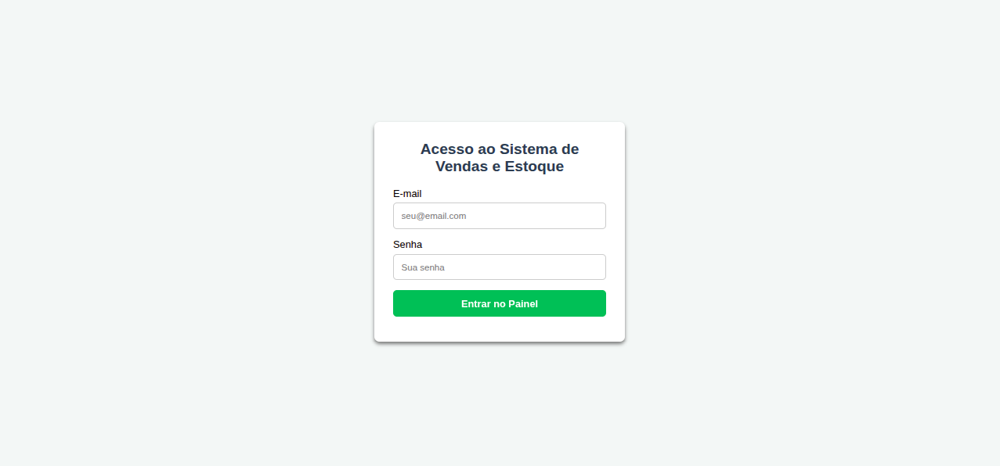
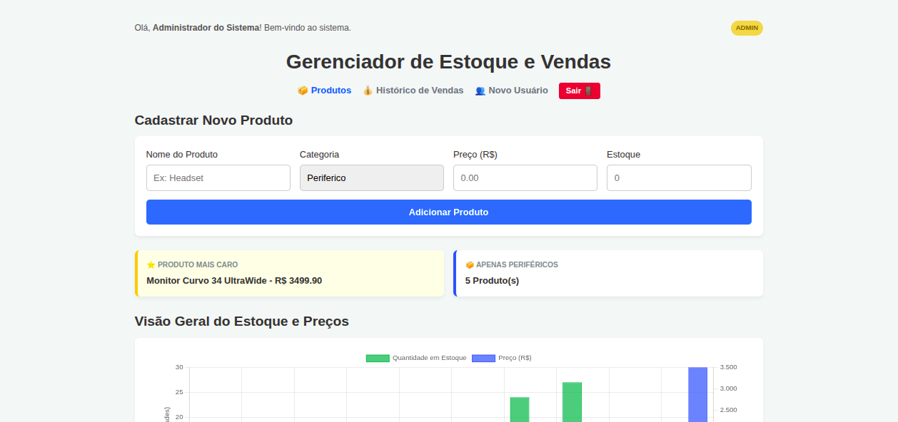
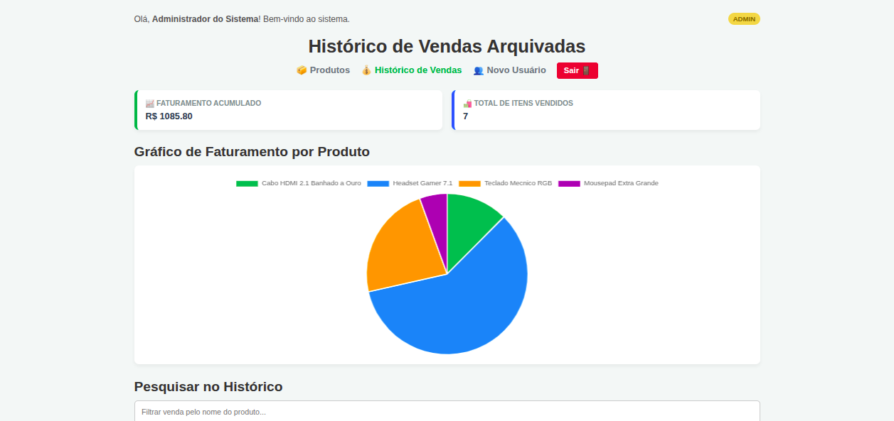
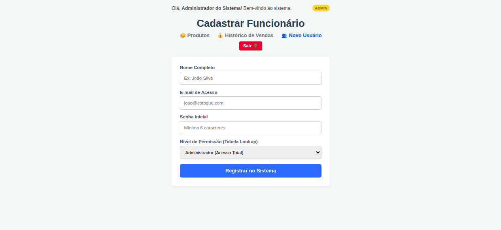

# 📦 Sistema de Controle de Estoque e Vendas (Vanilla JS)

Dashboard gerencial Full-Stack e responsivo para controle de estoque e auditoria de faturamento de produtos, integrado a um banco de dados relacional e protegido por barreiras criptográficas de autenticação.

---

## 🛠️ Tecnologias Utilizadas

O projeto foi construído do zero utilizando as seguintes tecnologias, conceitos modernos e padrões arquiteturais:

### 🌐 Front-end (Interface Web)

- **HTML5 Semântico**: Estruturação rígida e organizada de tabelas (`<table>`, `<thead>`, `<tbody>`, `<tr>`, `<th>`, `<td>`).
- **CSS3 Responsivo**: Uso de **CSS Grid**, **Flexbox** e **Media Queries** com abordagem _Mobile-First_ para perfeita adaptação em Celulares, Tablets e Desktops.
- **JavaScript (ES6+ Puro)**:
  - **Abordagem Funcional de Arrays**: Manipulação avançada de dados com `.map()`, `.filter()`, `.reduce()` e `.some()`.
  - **Sintaxe Moderna**: Atribuição via Desestruturação (_Destructuring Assignment_) de Objetos e Arrays, e uso do Operador Rest (`...`).
  - **Comunicação Assíncrona**: Uso de `async/await` e tratamento de fluxos e erros em Promises.
- **Axios**: Centralização de requisições HTTP, interceptores de cabeçalhos globais e tratamento automatizado de fluxos de sucesso e erro (401/403).
- **Chart.js**: Renderização dinâmica de gráficos interativos de barras e setores (pizza) para tomada de decisão gerencial.

### 🖥️ Back-end (Servidor e API)

- **Node.js & Express**: Criação de uma API RESTful modularizada escalável seguindo o padrão arquitetural **MVC** (Model-View-Controller).
- **ECMAScript Modules**: Uso moderno de importações com `import/export` nativos (`"type": "module"`).
- **Dotenv (.env)**: Isolamento seguro de credenciais sensíveis e chaves de rede fora do código-fonte.

### 🗄️ Segurança e Banco de Dados

- **MySQL**: Armazenamento permanente com modelagem relacional, chaves estrangeiras (`FOREIGN KEY`) e tabelas de referência lookup normalizadas.
- **SQL Avançado**: Consultas relacionais com `INNER JOIN` e manipulações seguras de persistência (`SELECT`, `INSERT`, `UPDATE`, `DELETE`).
- **Database Transactions**: Uso de travas e blocos de segurança (`beginTransaction`, `commit`, `rollback`) para garantir a consistência física do estoque e das vendas.
- **JSON Web Tokens (JWT)**: Emissão e validação de tokens digitais temporários para controle rigoroso de sessão e expiração de acessos.
- **BcryptJS**: Criptografia e encriptação segura de senhas via hashes matemáticos irreversíveis antes do salvamento no MySQL.

---

## 📸 Demonstração do Sistema (Screenshots)

Aqui estão as capturas de tela do sistema rodando diretamente no navegador web:

### 1. Tela de Login e Acesso Seguro

<!-- Substitua o link 'URL_DA_SUA_IMAGEM_AQUI' pelo caminho ou URL da imagem do seu login -->



### 2. Painel de Controle e Estoque de Produtos (Visão do Administrador)

<!-- Substitua o link 'URL_DA_SUA_IMAGEM_AQUI' pelo caminho ou URL da imagem do painel principal -->



### 3. Histórico e Gráficos de Pizza de Auditoria de Vendas

<!-- Substitua o link 'URL_DA_SUA_IMAGEM_AQUI' pelo caminho ou URL da imagem da tela de vendas -->



### 4. Interface Visual de Cadastro de Novos Funcionários

<!-- Substitua o link 'URL_DA_SUA_IMAGEM_AQUI' pelo caminho ou URL da imagem da tela de novos usuários -->



---

## 🚀 Como Executar o Projeto Localmente (Ubuntu/Linux)

### 1. Clonar o Repositório e Preparar as Pastas

```bash
git clone https://github.com
cd https://github.com/aldosds/estoque-e-vendas-mysql-api-axios-html-css-javascript.git
```

### 2. Configurar o Banco de Dados (MySQL)

Abra o console do seu MySQL e execute o script para criar a estrutura relacional normalizada:

```sql
CREATE DATABASE sistema_estoque;
USE sistema_estoque;

CREATE TABLE niveis_acesso (
    id INT AUTO_INCREMENT PRIMARY KEY,
    nome VARCHAR(50) NOT NULL UNIQUE
);

INSERT INTO niveis_acesso (nome) VALUES ('admin'), ('operador');

CREATE TABLE usuarios (
    id INT AUTO_INCREMENT PRIMARY KEY,
    nome VARCHAR(100) NOT NULL,
    email VARCHAR(100) NOT NULL UNIQUE,
    senha VARCHAR(255) NOT NULL,
    nivel_acesso_id INT NOT NULL,
    CONSTRAINT fk_usuario_nivel_acesso FOREIGN KEY (nivel_acesso_id) REFERENCES niveis_acesso(id)
);

CREATE TABLE produtos (
    id INT AUTO_INCREMENT PRIMARY KEY,
    nome VARCHAR(150) NOT NULL UNIQUE,
    categoria VARCHAR(50) NOT NULL,
    preco DECIMAL(10, 2) NOT NULL,
    estoque INT NOT NULL
);

CREATE TABLE vendas (
    id INT AUTO_INCREMENT PRIMARY KEY,
    produto_id INT NOT NULL,
    quantidade INT NOT NULL,
    preco_unitario DECIMAL(10, 2) NOT NULL,
    valor_total DECIMAL(10, 2) NOT NULL,
    data_venda TIMESTAMP DEFAULT CURRENT_TIMESTAMP,
    FOREIGN KEY (produto_id) REFERENCES produtos(id) ON DELETE CASCADE
);
```

### 3. Configurar e Inicializar o Back-end

Entre na pasta do back-end, crie o arquivo `.env` com suas credenciais do MySQL e inicialize:

```bash
cd backend
npm install
node server.js
```

### 4. Inicializar o Front-end

Abra a pasta `frontend` utilizando a extensão **Live Server** do VS Code ou abra o arquivo `login.html` no seu navegador favorito.

---

Desenvolvido com foco no aprendizado prático de padrões arquiteturais e engenharia de software de alta performance. 🏁
